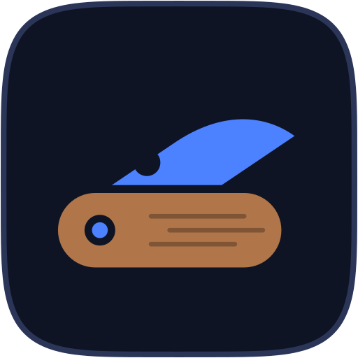

<p align="center"></p>

# Knivchit

**English** | [Español](README.es.md)

Created by [Kevin Charpentier](https://github.com/kevincharp).

> **Early preview, not stable yet.** Expect rough edges and breaking changes between versions. Settings and data may be migrated or reset, so back up anything you care about.

**Screenshots with annotations, built for GNOME on Wayland.** Knivchit freezes your screen, lets you draw a rounded selection, mark it up with arrows, text and mosaic, then copy, save or pin the result. Everything stays on your machine: no accounts, no telemetry, and no network except when you ask it to check for updates.

<!-- IMAGE: real screenshot of the capture overlay (docs/img/overlay.png). Pending. -->

Website: <https://knivchit.pages.dev> · Repository: <https://github.com/kevincharp/knivchit>

## Status

Version 0.1 does one thing: screenshots.

| Feature | Status |
|---|---|
| Rounded or sharp selection, movable and resizable | Available |
| Annotate: arrow, rectangle, ellipse, pen, editable text, mosaic brush, eraser; undo and redo | Available |
| Copy, save, save as, pin on screen | Available |
| Configurable shortcut, dark and light themes | Available |
| Clipboard history | Coming soon |
| OCR (text from the screen) and translation | Coming soon |
| Emoji panel and stickers | Coming soon |

"Coming soon" means planned, with no dates. Tested on **GNOME 50 on Wayland**; the extension declares support for GNOME 50 only. The app's interface is in Spanish for now; an English interface is planned.

## Requirements

- GNOME Shell on **Wayland** (X11 and other desktops are untested).
- **Xwayland** available (on by default in Fedora and Ubuntu). The AppImage starts in X11 mode (`GDK_BACKEND=x11`); on a Wayland session the app switches to `wayland,x11`, so Xwayland is the fallback it relies on.
- `fuse3` to run AppImages, or start it with `--appimage-extract-and-run`.
- To build: Node 24, pnpm 12.4.1, Rust stable ≥ 1.77.2 and Tauri v2's system dependencies (WebKitGTK 4.1, etc.).

## Install

The script downloads the latest release and **verifies its SHA-256 sums (`SHA256SUMS`) before touching anything**. Download it first, read it, then run it:

```sh
curl --proto '=https' --tlsv1.2 -fsSL https://raw.githubusercontent.com/kevincharp/knivchit/main/install.sh -o install.sh
less install.sh
bash install.sh
```

It installs the AppImage in `~/.local/bin`, the application menu entry, the D-Bus activation and the GNOME Shell extension. Then **log out and back in** (on Wayland, GNOME only loads new extensions at session start) and assign your shortcut in Settings. To uninstall: `bash install.sh --uninstall` (your captures and data are left alone).

While no stable release exists, the script installs the latest release **even if it is a pre-release** and says so first ("installing PRE-RELEASE v0.1.0-alpha.3"). `bash install.sh --stable` requires a stable version (it fails if there are only pre-releases); `bash install.sh --version v0.1.0-alpha.3` pins one. To test a local candidate offline: `bash install.sh --from-dir <folder with the AppImage, the extension zip and SHA256SUMS>`.

By hand:

1. From the release page (<https://github.com/kevincharp/knivchit/releases>; pre-releases don't show as "Latest") download the AppImage, the extension zip and `SHA256SUMS`, and check the sums: `sha256sum -c SHA256SUMS --ignore-missing`.
2. `chmod +x` the AppImage and run it wherever you like.
3. Install the extension with `gnome-extensions install --force <file.zip>`, log out and back in, and enable it with `gnome-extensions enable knivchit@knivchit.dev`.

Without the extension the capture tool works from the main window's button, but there is no global shortcut and pinned captures don't stay on top.

### Screen-capture permission

The first time you capture, GNOME asks (through the desktop portal) whether Knivchit may take screenshots. The answer is remembered **per application id, `knivchit`** (the name of `knivchit.desktop`, which is also the window class), so it is the same whether Knivchit was started from the application menu or by the shortcut through D-Bus activation. To make GNOME forget the answer and ask again:

```sh
flatpak permission-reset knivchit
# without flatpak installed, the same thing through the permission store:
gdbus call --session --dest org.freedesktop.impl.portal.PermissionStore \
  --object-path /org/freedesktop/impl/portal/PermissionStore \
  --method org.freedesktop.impl.portal.PermissionStore.DeletePermission screenshot screenshot knivchit
```

### Known issues

- If the window misbehaves (position, scale, focus), try forcing the backend: `GDK_BACKEND=wayland ./Knivchit.AppImage`. The app only replaces the `x11` value set by the AppImage; any other value you set is respected.

## Shortcuts

**There is no default shortcut.** You record one in the app's Settings and it warns you if it clashes with a GNOME one. The extension registers it in the Shell and starts the capture over D-Bus.

In the overlay: drag to select, move or resize with the eight handles, pick a tool from the toolbar, and finish by copying, saving or pinning. `Esc` cancels.

## Build

```sh
cd app && pnpm install --frozen-lockfile
pnpm tauri dev                                   # development (app + frontend)
APPIMAGE_EXTRACT_AND_RUN=1 NO_STRIP=1 pnpm tauri build --bundles appimage   # AppImage
```

A plain `cargo build --release` does **not** produce a usable binary (it doesn't rebuild the frontend). The two environment variables avoid real failures on machines without `libfuse.so.2` or with a modern `ld` emitting `.relr.dyn`.

## Test

The gate that must pass before anything is considered done:

```sh
cd app && pnpm exec tsc --noEmit && pnpm exec biome check . \
  && cargo test --manifest-path src-tauri/Cargo.toml && pnpm exec vitest run
```

The extension is tested separately, on a private D-Bus: `dbus-run-session -- gjs -m extension/tests/<file>.test.js`. The website: `node landing/scripts/check.mjs`.

## Architecture in brief

Two pieces with different stacks, on purpose:

- **`app/`**: Tauri v2 (Rust) + React. It is the whole product (capture, annotation, settings). The frontend composes the final image; the backend only validates, saves, copies and pins.
- **`extension/`**: a GNOME Shell extension (GJS) that does what only the compositor can do on Wayland (global shortcut, window placement, keeping pinned windows on top). No UI and no business logic.

They talk over D-Bus. More in [`docs/architecture.md`](docs/architecture.md).

## Contributing

Knivchit is issues-first: open an issue with the bug or feature template. Pull requests are accepted only against an issue the maintainer has approved, or for very small fixes. See [`CONTRIBUTING.md`](CONTRIBUTING.md), [`docs/branches.md`](docs/branches.md) and the [code of conduct](CODE_OF_CONDUCT.md). Report vulnerabilities privately: [`SECURITY.md`](SECURITY.md).

## Licenses

- `app/`: **MIT** ([`app/LICENSE`](app/LICENSE)).
- `extension/`: **GPL-3.0-or-later** ([`extension/LICENSE`](extension/LICENSE)), because it runs inside GNOME Shell.
- Website typefaces (Inter, Bricolage Grotesque): SIL OFL 1.1.
- `landing/`, `docs/` and everything else: **MIT**, © 2026 Kevin Charpentier (see [`LICENSE`](LICENSE)).
